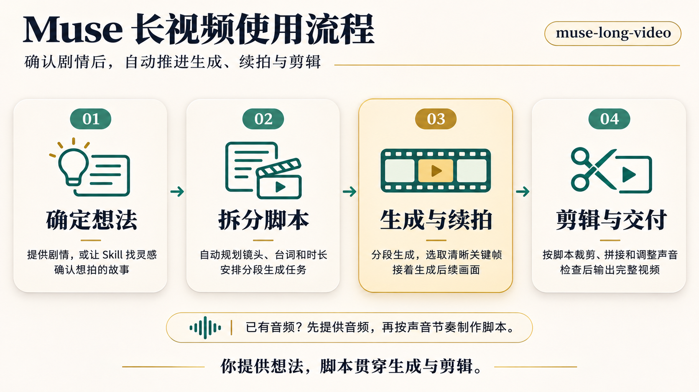

# Muse 长视频 Skill：星幕画布 / 自带 API

从一个想法出发，让 Agent 自动拆分剧情、规划脚本、安排分段生成，再通过关键帧续拍和脚本剪辑，完成一条完整的长视频。

**查看详细案例：** 前往作者 **[无敌的阿杰 · @AJCreatesAI](https://x.com/AJCreatesAI)** 的 X 账号，查看视频案例、实际效果和制作过程分享。

**你主要负责提供想法、确认剧情，以及需要时提出修改。** 在生成通道配置完成、费用范围确认后，后续制作由 Agent 按脚本推进，无需手动逐段生成、抽帧和拼接；遇到必须由你决定的问题时再反馈。

**先选择生成方式，再检查环境。** 同一套规划、参考帧、剪辑和验收流程，可使用星幕，也可使用自带的兼容视频API。接口兼容不等于一定保脸或无缝接续，成片仍需检查。

## 四步完成长视频

### 01 — 提供剧情，或让 Skill 帮你找灵感

你可以直接提供故事、场景或一个简单的想法，例如“做一条街边监控视角的30秒视频”。如果还没有方向，也可以让 Skill 搜集视频参考和剧情灵感，再由你选择、调整并确认。

### 02 — 自动拆分剧情，规划脚本和生成任务

剧情确认后，Agent 会把故事拆成适合分段生成的镜头，安排动作、表情、台词和时长，并编写每段的生成提示词。

**这份脚本不仅用于生成，也作为后续剪辑的依据**：每段应该保留什么、如何衔接、什么时候出现对白，都围绕同一份脚本展开。

### 03 — 分段生成，通过关键帧接续后续画面

先生成第一段，再从实际画面中挑选人物、服装和场景清楚的关键帧，作为下一段的参考，继续生成后续内容。按这个方式逐段推进，直到故事完整。

关键帧不一定是最后一帧。选用中间帧续拍时，前一段也会裁剪到对应接点，避免动作重复或画面倒退。

### 04 — 按脚本裁剪、拼接并交付成片

Agent 按脚本和实际素材裁剪片段、拼接接点、保留完整对白，并按需求处理音效与BGM。检查画面衔接、人物一致性和音画同步后，输出完整视频。

## 单段时长与长视频

按本项目当前使用的 Muse API 口径，**可通过提示词描述单段目标时长，最短2秒、最长10秒**。Agent 根据剧情节奏分配各段时长，再通过接续生成和剪辑组成更长的视频，不必把每段都固定成10秒。

这里的2–10秒来自维护者提供的当前接入链路使用说明，并非所有服务商统一的API参数规范。使用自己的API时仍需核对所选模型与接口能力；提示词中的目标时长也不替代对实际生成文件的时长检查。

## 已有音频，也可以先从声音开始

如果已经有配音、对白或其他音频文件，可以先交给 Agent。它会结合音频内容、时长、停顿和节奏规划画面与分段脚本，再安排生成和剪辑。需要保留原音频时，以原音频为时间轴对齐画面，不随意截断或改写内容。

也就是说，**既可以先有故事，再生成视频；也可以先有声音，再为声音安排画面。**

## 2026-11-17 更新

- 补充四步使用流程及简洁流程图。
- 说明脚本贯穿分段生成与最终剪辑。
- 补充当前Muse链路的2–10秒时长口径，以及先提供音频的用法。

## 2026-11-16 更新

- 新增星幕/API选择，不再强制安装星幕。
- API使用自己的地址、私密Key和准确模型，不绑定服务商。
- 视频API执行器支持限定协议的只读检查、上传、提交、查询、下载与恢复。
- 升级备份移出技能扫描目录；测试不再额外依赖NumPy。

## 安装

仓库地址：https://github.com/AJbeckliy/muse-long-video 。可点击 **Code → Download ZIP** 下载并解压。

把解压后的整个包交给能操作本机文件和脚本的AI助手，告诉它：

> 从 https://github.com/AJbeckliy/muse-long-video 安装Muse长视频Skill，Skill入口在仓库的 muse-long-video 子目录。先问我用星幕还是自己的API，按照选择配置。API模式不要安装或启动星幕。先检查环境，不生成视频。

Windows也可双击`install-windows.cmd`。需可用的Python 3.10/3.11 x64（[Python下载](https://www.python.org/downloads/windows/)），安装助手会创建独立剪辑环境。

### 星幕画布

1. [下载星幕](https://pan.quark.cn/s/cf3c1e40528d#/list/share)，安装并登录自己的账号。
2. 安装助手选“1”，选择程序和媒体目录，用自己星幕提供的配对信息；已有连接复用。
3. 真实连接检查通过后，核对Muse权限和余额，再制作。

网盘由发布者提供，未核验其中安装包版本。配对Token只存本机，生成消耗自己的额度。

### 自带API

1. 安装助手选“2”，无需星幕，不修改星幕MCP。
2. 提供API地址、文档、准确模型名称；Key通过安全输入或本机`MUSE_VIDEO_API_KEY`环境变量配置，不发到聊天。
3. 助手核对鉴权、上传、参数、轮询、参考帧和音频能力，做只读检查；兼容后才按制作授权生成。
4. 
没有现成接口的，可以从这个(https://api.seedance.nz/?s=0M1u)开始，方便快速用起来。直接将文档页面的链接发给你的agent配置即可。

本包支持限定的`video_async_json_v1`协议，或用户已有的适用专用连接器。**不是所有“兼容OpenAI”的API都支持视频，也不是所有视频API都支持参考帧接续。** 不匹配则说明原因并停止，不自动换服务或模型。

选“3”只安装共享文件，稍后选择。已有通道默认沿用，需要切换时明确告诉助手；高级用户可传`setup_windows.ps1 -Backend api`或`-Backend starcanvas`覆盖保存偏好。

## 使用

> 用 $muse-long-video，把这个剧情做成30秒长视频。人物用我的图，先给分段脚本，沿用已选通道。

> 用 $muse-long-video，从这条视频合适的中间帧续拍，保持人物、服装和场景。

> 用 $muse-long-video，只剪辑已有片段，不调用生成。

> 用 $muse-long-video，帮我找几个适合街边监控视角的剧情灵感，我选好后再做成30秒视频。

> 这是我的配音文件。用 $muse-long-video，根据音频内容和节奏规划脚本，生成并剪成匹配这段音频的视频。

流程：剧情脚本 → 分段生成 → 中间帧续拍 → 按帧剪辑 → 原声/BGM → 验收交付。

交付MP4、实际提示词、剪辑表与制作记录；不自动发布，不默认交剪映工程。媒体目录由使用者选择，不要求H盘。

## 文档与验证

- [Skill入口](muse-long-video/SKILL.md)
- [通道选择](muse-long-video/references/backend-selection.md)
- [API协议和限制](muse-long-video/references/api-execution.md)
- [星幕接入](muse-long-video/references/synmew-install.md)
- [验证范围](muse-long-video/references/validation.md)

包内不含作者密钥、配对信息、人物素材、项目媒体、Python或星幕安装器。共享脚本依赖PyAV、Pillow和FFmpeg辅助包；配置解析用tomli，助手会联网安装。

已做本机离线测试及原星幕只读连接实测。新增REST协议未跑线上付费视频，全新电脑安装尚未完整实测。勿宣传任意API通用或安装后无需配置。
